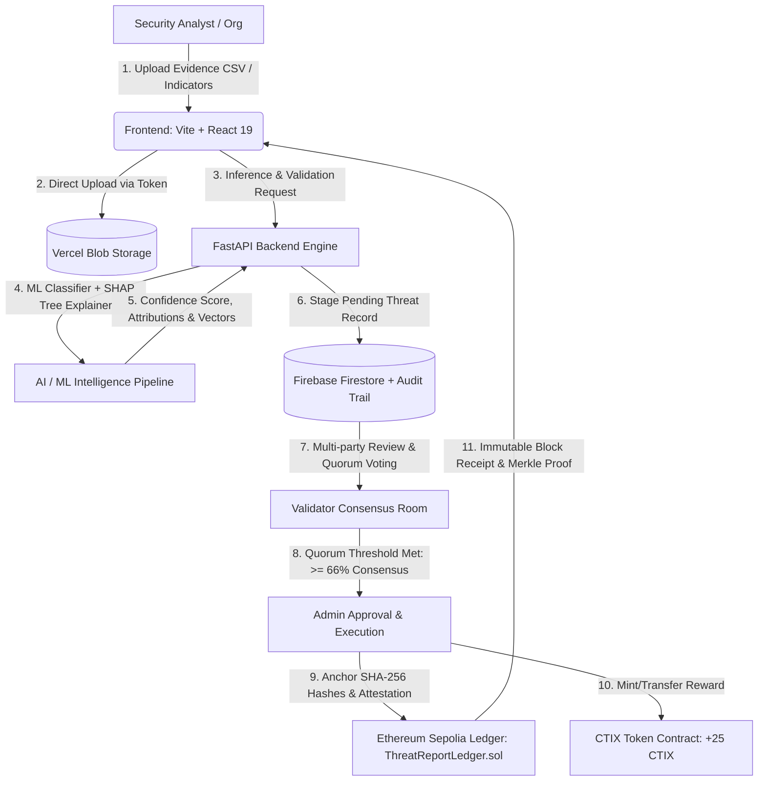

# CTI / ANCHOR · Decentralized Cyber Threat Intelligence Sharing Platform

[](https://decentralized-cti.vercel.app)
[](https://sepolia.etherscan.io)
[](https://backend-nine-smoky-22.vercel.app)
[](https://decentralized-cti.vercel.app)
[](LICENSE)

An enterprise-grade, decentralized Cyber Threat Intelligence (CTI) sharing platform engineered for collective defense. Built with **EVM Smart Contracts**, **Explainable Artificial Intelligence (XAI / SHAP)**, **Privacy-Preserving Federated Learning (FedAvg)**, and **Decentralized Validator Quorum Consensus**.

---

## 🌐 Live Production Deployments

| Component | Production URL | Network / Host |
| :--- | :--- | :--- |
| **Primary Web Application** | [https://decentralized-cti.vercel.app](https://decentralized-cti.vercel.app) | Vercel Global Edge (308 Canonical Redirect from legacy URLs) |
| **Backend REST API** | [https://backend-nine-smoky-22.vercel.app](https://backend-nine-smoky-22.vercel.app) | FastAPI / Vercel Serverless (GZip + CORS 24h cache) |
| **API Health Status** | [https://backend-nine-smoky-22.vercel.app/api/health](https://backend-nine-smoky-22.vercel.app/api/health) | `{"status": "ok"}` |
| **Threat Ledger Contract** | [`0x5FbDB2315678afecb367f032d93F642f64180aa3`](https://sepolia.etherscan.io/address/0x5FbDB2315678afecb367f032d93F642f64180aa3) | Ethereum Sepolia Testnet |
| **CTIX Incentive Token Contract**| [`0x8A791620dd6260079BF849Dc5567aDC3F2FdC318`](https://sepolia.etherscan.io/address/0x8A791620dd6260079BF849Dc5567aDC3F2FdC318) | ERC-20 Incentive Token Ledger |

---

## 🏛️ System Architecture



---

## ✨ Key Features & Technical Highlights

### 1. "Obsidian Sentinel" Command Center UI/UX
- High-contrast, dark aesthetic inspired by Linear, CrowdStrike, and Etherscan.
- Dark theme tokens: Background (`#09090B`), Surface (`#111114`), Elevated (`#18181D`), Cyan Accent (`#22D3EE`), Violet AI Accent (`#8B5CF6`).
- Responsive, hover-expandable navigation sidebar with manual pin lock.
- Zero-latency inline SVG favicon integrating Cyber Shield, Blockchain Cube, and AI Core.

### 2. Explainable AI (SHAP Waterfall Attribution)
- Transparent model explainability via Shapley Values ($\phi_i$).
- Displays baseline expectation $E[f(x)]$ and positive/negative push factors for each network feature (packet rate, syn flood, flow duration, spoofed CIDR).
- Delivers auditable, court-admissible threat explanations for SOC teams.

### 3. Federated Learning Consortium Simulator (FedAvg)
- Interactive simulation of decentralized threat model aggregation across 5 participating organizations (banks, healthcare, telecom).
- Local training rounds with private gradient sharing and global model aggregation without exposing sensitive raw network telemetry.

### 4. Machine Learning Evaluation Suite
- **Interactive ROC Curve** with high Area Under the Curve (AUC = 0.992).
- **Confusion Matrix** with dynamic decision threshold slider ($\tau \in [0.0, 1.0]$) dynamically updating True Positives, False Positives, True Negatives, False Negatives, Precision, Recall, and F1-score with zero latency.

### 5. Smart Contract Architecture & CTIX Tokenomics
- **`ThreatReportLedger.sol`**: Anchors SHA-256 report hash, sensitive data hash, organization identity, evaluated record count, and timestamp on Ethereum Sepolia.
- **`CTIToken.sol`**: Decentralized ERC-20 incentive mechanism rewarding validators and vetted contributors with +25 CTIX tokens per verified submission.
- **`OnChainProofModal`**: In-app cryptographic proof inspector linking directly to Sepolia Etherscan with one-click copy and transaction verification.

### 6. Dual-Mode Authentication
- Firebase Authentication supporting email/password and Google OAuth with automatic account chooser (`prompt: select_account`) and redirect fallback.
- Granular Role-Based Access Control (RBAC): `Admin` (approval & anchoring authority) vs. `Uploader` (incident reporter & analyst).

### 7. STIX 2.1 Threat Sharing
- Export threat feed items directly to standard **STIX 2.1 JSON** objects for interoperability with MISP, OpenCTI, and Splunk.

---

## 📂 Project Directory Structure

```text
cti/
├── backend/
│   ├── api/
│   │   └── index.py             # Serverless ASGI entrypoint for Vercel
│   ├── app/
│   │   ├── main.py              # FastAPI endpoints, CORS, compression middleware
│   │   ├── auth.py              # Firebase JWT verification & RBAC enforcement
│   │   ├── blockchain_client.py # Web3.py client for Ethereum Sepolia & Hardhat
│   │   ├── pipeline.py          # Threat parsing, feature extraction & ML inference
│   │   └── store.py             # Firestore storage abstraction & audit log
│   ├── requirements.txt         # Python dependencies (FastAPI, Web3, Pandas, Scikit-learn)
│   └── vercel.json              # Python runtime configuration for backend deployment
├── contracts/
│   ├── contracts/
│   │   ├── ThreatReportLedger.sol # On-chain threat anchoring ledger contract
│   │   └── CTIToken.sol           # CTIX ERC-20 incentive reward token contract
│   ├── scripts/
│   │   └── deploy.js            # Hardhat deployment script with automated .env sync
│   └── hardhat.config.js        # Hardhat configuration (local & Sepolia networks)
├── frontend/
│   ├── public/
│   │   └── favicon.svg          # High-resolution vector favicon
│   ├── src/
│   │   ├── components/
│   │   │   ├── auth/            # AuthModal (Credentials & Google OAuth)
│   │   │   ├── layout/          # AppNavbar, AppSidebar (hover-expandable), AppFooter
│   │   │   ├── pages/           # 9 Core sections (Dashboard, Feed, Consensus, AiInsights...)
│   │   │   └── ui/              # Primitives, overlays, domain chips, Badges
│   │   ├── hooks/               # useThreatStore, useWallet
│   │   ├── styles/              # index.css (Obsidian Sentinel theme tokens & grid)
│   │   ├── api.js               # In-memory cached API fetch wrapper
│   │   ├── firebase.js          # Client-side Firebase configuration
│   │   ├── threatData.js        # Realistic IOC models, SHAP telemetry & contract ABIs
│   │   └── ModernApp.jsx        # Root application shell & routing
│   ├── index.html               # Head tags, fonts preconnect, canonical redirect
│   ├── package.json             # React 19, Lucide, Recharts, Vite, Tailwind CSS
│   └── vercel.json              # Edge 308 permanent redirect & SPA rewrite rules
├── LOCAL_RUNBOOK.md             # Detailed guide for running locally & configuring Sepolia
└── README.md                    # Project documentation
```

---

## ⚡ Quick Start (Local Development)

### Prerequisites
- **Node.js**: `v18.x` or `v20.x` or later
- **Python**: `v3.10` or `v3.11` or `v3.12`
- **Git**

### Step 1: Clone Repository
```bash
git clone https://github.com/sonakshi555/cyber-threat-intelligence-sharing-using-Blockchain.git
cd cyber-threat-intelligence-sharing-using-Blockchain
```

### Step 2: Start Local Smart Contract Blockchain (Hardhat)
```bash
cd contracts
npm install
node node_modules/hardhat/internal/cli/cli.js node
```
*In a second terminal, deploy the ledger contract:*
```bash
cd contracts
node node_modules/hardhat/internal/cli/cli.js run scripts/deploy.js --network localhost
```
*The deployment script automatically synchronizes the contract address into `backend/.env`.*

### Step 3: Start FastAPI Backend
```bash
cd backend
python -m venv .venv
# On Windows PowerShell:
.venv\Scripts\activate
# On Linux / macOS:
source .venv/bin/activate

pip install -r requirements.txt
uvicorn app.main:app --reload --port 8000
```
Verify the backend is live at `http://127.0.0.1:8000/api/health`.

### Step 4: Start Frontend (Vite)
```bash
cd frontend
npm install
npm run dev
```
Open `http://localhost:5173` in your browser.

---

## 🔐 Environment Variables

### Backend (`backend/.env`)
```env
RPC_URL=https://sepolia.infura.io/v3/YOUR_INFURA_KEY
CONTRACT_ADDRESS=0x5FbDB2315678afecb367f032d93F642f64180aa3
BLOCKCHAIN_PRIVATE_KEY=0xYOUR_SEPOLIA_WALLET_PRIVATE_KEY
FRONTEND_ORIGINS=http://localhost:5173,http://127.0.0.1:5173,https://decentralized-cti.vercel.app
ADMIN_EMAILS=admin@cyberanchor.io,your-email@example.com
FIREBASE_SERVICE_ACCOUNT_JSON={"type":"service_account",...}
```

### Frontend (`frontend/.env`)
```env
VITE_API_URL=http://localhost:8000
VITE_FIREBASE_API_KEY=your-firebase-api-key
VITE_FIREBASE_AUTH_DOMAIN=your-project.firebaseapp.com
VITE_FIREBASE_PROJECT_ID=your-project-id
VITE_FIREBASE_STORAGE_BUCKET=your-project.firebasestorage.app
VITE_FIREBASE_MESSAGING_SENDER_ID=your-sender-id
VITE_FIREBASE_APP_ID=your-app-id
```

---

## 📜 Smart Contract Reference

### `ThreatReportLedger.sol`
```solidity
struct ReportRecord {
    uint256 id;
    string organizationName;
    string attackType;
    bytes32 reportHash;
    bytes32 sensitiveDataHash;
    uint256 timestamp;
    address submitter;
    uint256 totalRecordsEvaluated;
}
```
- **`anchorReport(...)`**: Validates caller permissions, computes cryptographic ledger receipts, and emits `ReportAnchored`.
- **`getAllReports()`**: View function returning all on-chain anchored intelligence reports.

---

## 👥 Contributors & Academic Context

Developed as a Capstone Computer Science Thesis Project:
- **Domain**: Decentralized Systems, Applied Cryptography, Adversarial Machine Learning & Cyber Threat Intelligence.
- **Repository**: [github.com/sonakshi555/cyber-threat-intelligence-sharing-using-Blockchain](https://github.com/sonakshi555/cyber-threat-intelligence-sharing-using-Blockchain)
- **Live Platform**: [decentralized-cti.vercel.app](https://decentralized-cti.vercel.app)
